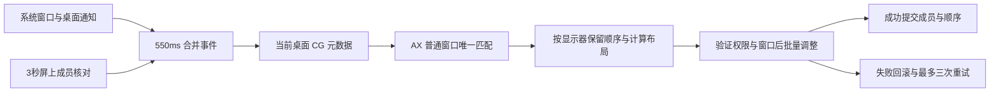

# v0.2 连续自动模式

原生 AppKit 常驻菜单栏，无服务端、网络或第三方运行时。UI 只调用已有窗口引擎。设置存 UserDefaults；窗口句柄、顺序与撤销历史只存内存。

CG 只取屏上 layer 0 普通应用窗口。AX 只接受标准窗口子角色，并再次检查最小化、全屏、可移动和可缩放状态。CG 与 AX 按位置尺寸唯一匹配；多个候选时跳过。不能由这个筛选推导所有 Space / Stage Manager 组合兼容。

指纹只包含 pid、窗口号和显示器，不含位置。自己设置位置不会形成循环。指纹和当前成员在成功后提交；失败和 AX 尚未就绪采用有上限的重试。通知根节点提前注册，真实新窗口事件可以重新触发发现。轮询不抢占尚未执行的合并任务。已有窗口的相对顺序通过每屏最多 80 个句柄保留。

未授权时只每两秒查询 AXIsProcessTrusted；授权生效后启动监听。代码不修改权限。专用验收参数同时限制 fixture bundle ID、PID 和内核进程启动时间，格式错误即退出；NSRunningApplication.launchDate 允许为空，不能单独充当直接启动程序的必需身份字段。

自动模式关闭拖边吸附。手动分屏、工作布局和撤销先暂停自动。用户按住鼠标时延后整理。超过每屏 12 窗口不执行本次布局。批量最小尺寸失败会回滚其他窗口；主线程 AX 存在短暂卡顿风险。
